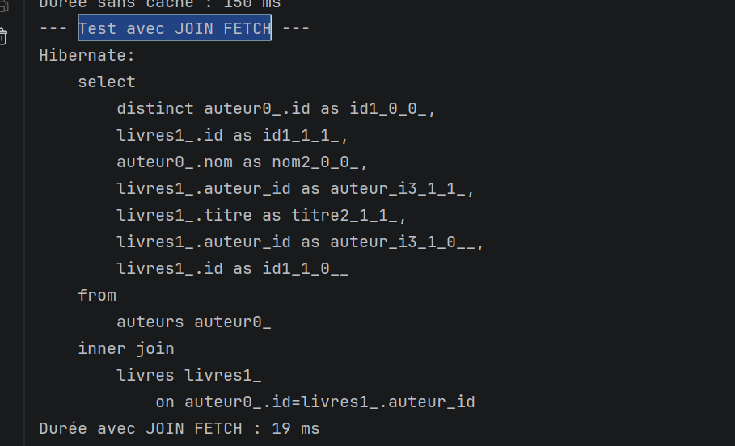
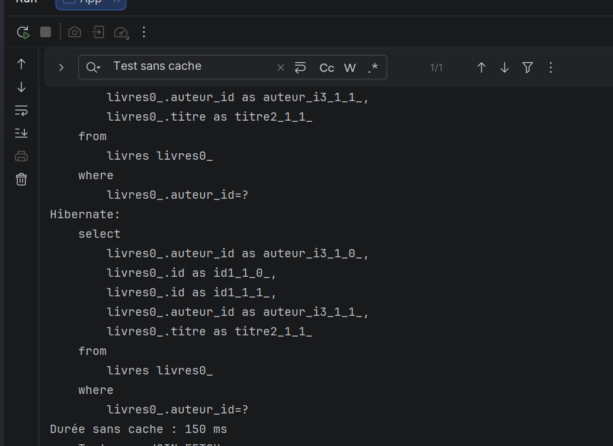
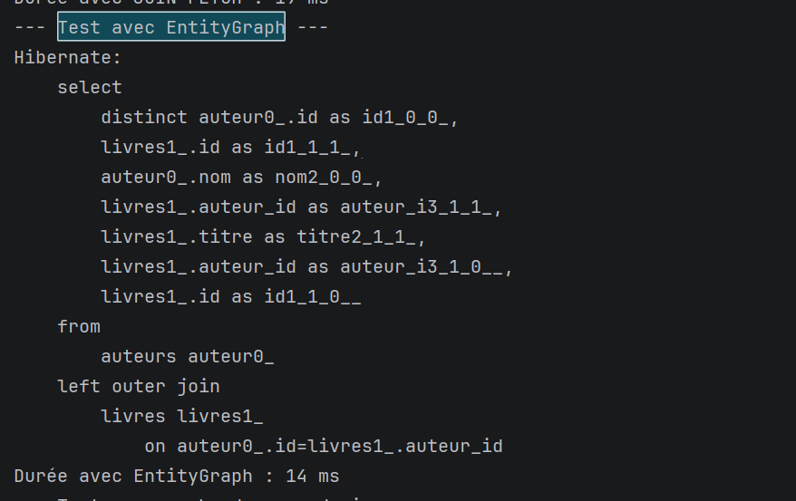
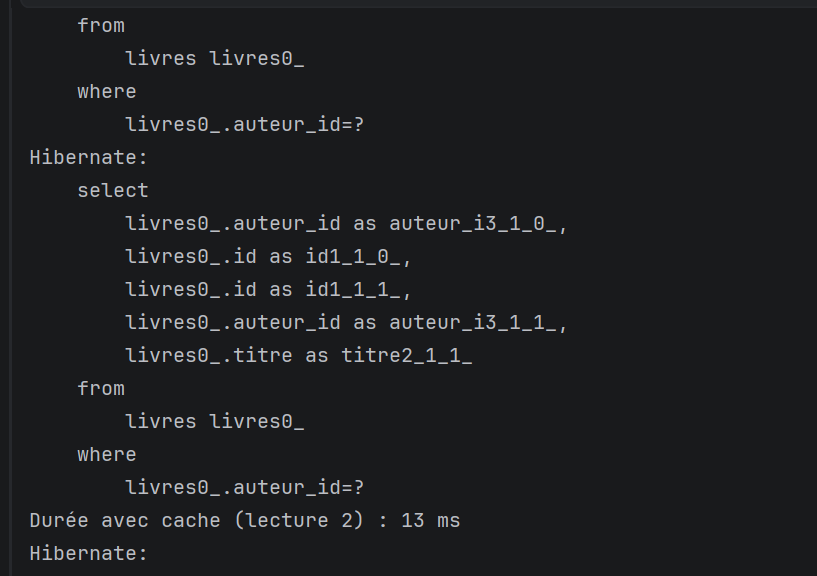

# Lab 9 — Cache de second niveau Hibernate (Ehcache 3 / JCache)

Comparaison de quatre manières de charger des `Auteur` avec leurs `Livre` :
requêtes N+1, `JOIN FETCH`, `EntityGraph` et cache de second niveau.

## Stack

| Élément | Version |
|---|---|
| Java | 11+ |
| Hibernate Core / JCache | 5.4.32.Final |
| Ehcache | 3.8.1 |
| H2 (en mémoire) | 1.4.200 |
| JPA | `javax.persistence` 2.2 |

## Structure

```
src/main/java/com/example
├── App.java                          # main : données + exécution des tests
├── model
│   ├── Auteur.java                   # @Cache, @NamedEntityGraph, @OneToMany livres
│   └── Livre.java                    # @Cache, @ManyToOne LAZY auteur
└── service
    ├── DataInitService.java          # insère 10 auteurs x 5 livres
    └── PerformanceTestService.java   # les 4 tests de performance
src/main/resources/META-INF
├── persistence.xml                   # unité "hibernate-cache-pu" (H2 + cache L2)
└── ehcache.xml                       # régions de cache
```

## Modèle

- `Auteur` 1 — N `Livre` (`mappedBy = "auteur"`, `cascade = ALL`, `orphanRemoval = true`).
- Entités et collection `Auteur.livres` annotées `@Cache(READ_WRITE)`.
- `@NamedEntityGraph("Auteur.livres")` charge les livres avec l'auteur.

## Configuration du cache

`persistence.xml` :

```xml
<property name="hibernate.cache.use_second_level_cache" value="true"/>
<property name="hibernate.cache.use_query_cache" value="true"/>
<property name="hibernate.cache.region.factory_class" value="org.hibernate.cache.jcache.JCacheRegionFactory"/>
<property name="hibernate.javax.cache.provider" value="org.ehcache.jsr107.EhcacheCachingProvider"/>
<property name="hibernate.javax.cache.uri" value="META-INF/ehcache.xml"/>
```

`ehcache.xml` définit les régions `com.example.model.Auteur`,
`com.example.model.Auteur.livres`, `com.example.model.Livre`,
`default-update-timestamps-region` et `default-query-results-region`.
Dans une `<cache>`, `<expiry>` doit être placé **avant** `<heap>`.

## Lancer

```bash
mvn clean compile exec:java -Dexec.mainClass=com.example.App
```

Sous IntelliJ : recharger Maven, puis exécuter `App.main`.

## Scénario de `main`

1. **Données de départ** : 10 auteurs x 5 livres (`initData`).
2. **Données ajoutées dans `main`** :
   - Victor Hugo : *Les Misérables*, *Notre-Dame de Paris*
   - Albert Camus : *L'Étranger*, *La Peste*
3. **Modification** : l'auteur d'id 1 devient « Naguib Mahfouz » et son premier livre « Impasse des deux palais ».
4. **Tests**, avec `em.clear()` avant chaque mesure :

| Test | Principe | Requêtes SQL attendues |
|---|---|---|
| Sans cache | `SELECT a FROM Auteur a`, puis accès à `getLivres()` | 1 + N (problème N+1) |
| `JOIN FETCH` | `SELECT DISTINCT a FROM Auteur a JOIN FETCH a.livres` | 1 |
| `EntityGraph` | `fetchgraph` sur `Auteur.livres` | 1 |
| Cache L2 | 1re lecture depuis la base, 2e lecture après `em.clear()` | 0 pour la 2e lecture |

Les durées sont affichées en ms. `hibernate.show_sql=true` permet de compter les requêtes
dans la console : la 2e lecture du test avec cache ne doit en produire aucune pour les livres.
Avec si peu de données, les écarts de temps sont faibles ; le nombre de requêtes est
l'indicateur le plus parlant.

## Résultats observés

Captures de la console (`hibernate.show_sql=true`), exécution sous IntelliJ :

| Test | Durée | Capture |
|---|---|---|
| Sans cache (N+1) | 150 ms |  |
| `JOIN FETCH` | 19 ms |  |
| `EntityGraph` | 14 ms |  |
| Cache L2 (lecture 2) | 13 ms |  |

- Sans cache, une requête `livres where auteur_id=?` est émise **par auteur** (N+1).
- `JOIN FETCH` (`inner join`) et `EntityGraph` (`left outer join`) chargent tout en **une seule requête**.
- La 1re mesure inclut le démarrage à froid de Hibernate : ne pas comparer les ms trop strictement.

## Erreurs courantes

| Erreur | Cause | Solution |
|---|---|---|
| `Unable to resolve ... JCacheRegionFactory` | `hibernate-jcache` absent du classpath | Dépendance `hibernate-jcache`, puis recharger Maven |
| `IllegalStateException: Transaction already active` | `begin()` appelé deux fois | La transaction est gérée uniquement dans `main` |
| Doublons d'auteurs avec `JOIN FETCH` | une ligne par livre | Utiliser `DISTINCT` |
| Cache jamais utilisé | session non vidée, `@Cache` manquant | `em.clear()` et `@Cache` sur entités et collection |
